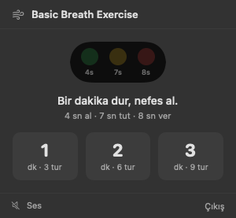
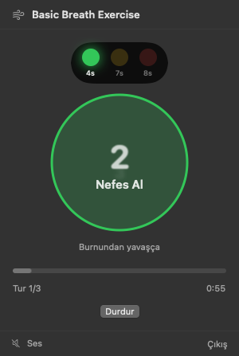
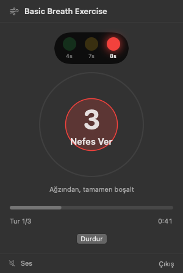

# Basic Breath Exercise

macOS menü çubuğunda duran, stresli anlar için 1–3 dakikalık bir nefes egzersizi koçu.

<p>
  
  
  
</p>

## Nasıl çalışır

Menü çubuğundaki ikona tıkla, süreyi seç (1, 2 veya 3 dk). 3'ten geri sayımdan sonra ışıklar sana eşlik eder:

| Işık | Faz | Süre |
|---|---|---|
| 🟢 | Nefes al | 4 sn |
| 🟡 | Tut | 7 sn |
| 🔴 | Nefes ver | 8 sn |

Bu, bilinen **4-7-8** tekniği. Bir tur 19 saniye; dakikada 3 tur yapılır (geri sayımla birlikte tam 60 sn).

Pencere kapalıyken de menü çubuğunda o anki fazın rengi ve kalan saniye görünür. Faz geçişlerinde kısa bir ses çalar (kapatılabilir).

## Kurulum

Xcode Command Line Tools ve macOS 14+ gerekir.

```bash
git clone https://github.com/cyb3rsalih/basic-breath-exercise.git
cd basic-breath-exercise
./build.sh
open "Basic Breath Exercise.app"
```

İstersen `.app` dosyasını Uygulamalar klasörüne taşıyıp Giriş Öğeleri'ne ekleyebilirsin.
